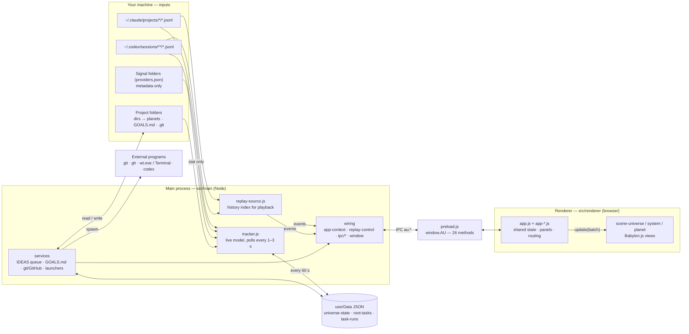
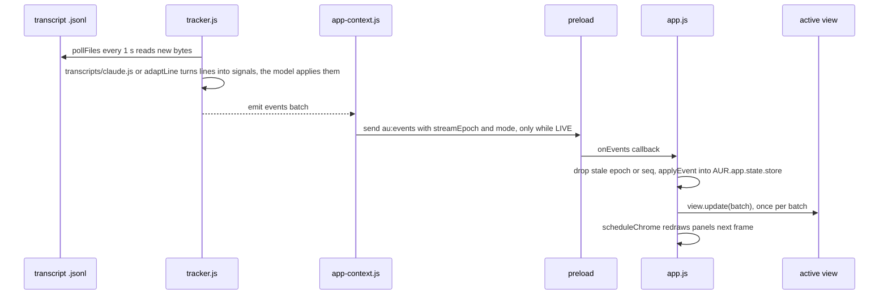
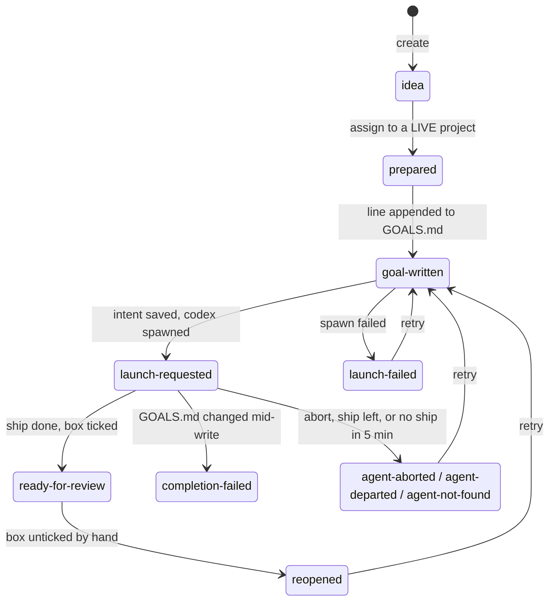
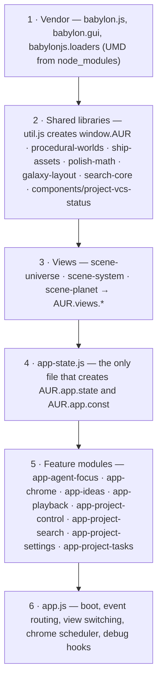

# Architecture — Agent Orrery

How the codebase is structured **today**, written for someone who finds it confusing.

- Snapshot: `main` after the 2026-10-07 cleanup (PRs #14–#22) and the fleet-v2 ships (2026-10-10).
  PR #11 had already split the old 2,217-line `src/main/main.js` into small files. Older docs
  still quote line numbers in the old `main.js`; §5.3 maps those to where the code lives now.
- Visual map: open [`architecture.html`](architecture.html) in a browser (works offline from disk).
  Deep links: `#trace=live|replay|ideas|terminal|git`, `#node=<id>` (e.g. `#node=tracker`), `#hot`, `#theme=light|dark`.

---

## 1. The one-minute version

Agent Orrery is an Electron desktop app that **watches** Claude Code and Codex work and
draws it as a universe. It never controls the agents (two narrow exceptions in §3).

- The **main process** (Node, `src/main/`) polls the transcript files that Claude Code and Codex
  already write to disk, turns them into a model (projects, ships, planets), and pushes small
  **event batches** to the window.
- The **preload** (`src/preload.js`) is the only door between the two halves: it exposes
  26 methods on `window.AU`, each a named IPC channel `au:*`.
- The **renderer** (browser, `src/renderer/`) keeps a copy of the model in one shared state
  object and draws it with Babylon.js in one of three views: universe → solar system → planet.

| Thing on screen | Comes from |
|---|---|
| Solar system (sun) | A project folder (one per working directory) |
| Galaxy | A group of projects that share a parent folder |
| Starship | A live Claude (neon purple) / Codex (blue) session, red on a local model; its hull class rises with the edits it has made |
| Drone | A Claude subagent (`Task`/`Agent` tool call) |
| Planet | A top-level folder inside the project; it grows as the agent edits files in it |
| Halo / "needs you" | A ship waiting on a question or permission |



---

## 2. App versus scaffolding

Most files in this repo are **not** the app. Only `src/` ships; everything else is art, tests,
or the record of how the app was built.

| Folder | Files | Size | What it is | Part of the running app? |
|---|---|---|---|---|
| `src/main/` + `src/preload.js` | 48 | 10,213 lines JS (1,345 of it test harness) | Main process | **Yes** (harness runs only with test flags) |
| `src/renderer/` | 29 | 7,280 lines JS + 3,042 HTML/CSS | Renderer (UI + 3D) | **Yes** |
| `assets/` | 347 | ~280 MB | Planet / skybox / asteroid textures, ship GLBs | Partly — see §8 |
| `test/` | 45 | 9,019 lines | Unit tests (`npm test`, Node's runner, no Electron) | No |
| `kit/` | 23 | — | Kit tooling, two stubs **and** 13 regression gate scripts | No (gates matter, see §9) |
| `scripts/` | 11 | — | One-step setup (run by the root `Install Agent Orrery.cmd` / `.command`), ship generators, the fleet-v2 LOD build, launcher shortcuts, demo screenshots and their synthetic profile, a VCS UI lab | No |
| `docs/` | 16 | — | Feature notes and plans; four of them are also gate fixtures | No |
| root | 11 | — | README, CLAUDE.md, SECURITY, LICENSE, `package.json` + lockfile, git config, 3 mockup PNGs | Mockups are the visual "gold samples" |
| `.github/` | 4 | — | CI (Ubuntu + Windows), Dependabot, CODEOWNERS, PR template | No |

Generated and ignored: `.shots/` (gate screenshots), `kit/done/*/output/` (old gate evidence),
`node_modules/`.

---

## 3. Where does feature X live?

Start here when you want to change something. Paths under "Main process" are relative to
`src/main/`, paths under "Renderer" to `src/renderer/`.

| Feature | Main process | IPC (`au:*`) | Renderer | Persisted in | Checked by |
|---|---|---|---|---|---|
| **Universe / system / planet views** | `tracker.js` (live model, `getSystem`, `getPlanet`); `ipc/register.js` | `snapshot`, `system`, `planet`, push `events` | `app.js` (routing), `scene-universe.js`, `scene-system.js`, `scene-planet.js` | `universe-state.json` (build counts) | `kit/grade.mjs`, polish + galaxy gates |
| **Galaxy grouping** | `tracker.js` `deriveGalaxy`; replay has its own `replayGalaxy` | in project payload | `galaxy-layout.js`, `scene-universe.js` | — | `grade-galaxies.mjs` |
| **Claude / Codex / Signal providers** | `provider-adapters.js`, `tracker.js` | push `events` | `util.js` (`PROVIDERS`, colours), `ship-assets.js` (hulls) | `providers.json` (Signal config, read-only) | `grade-providers.mjs` |
| **Needs-attention + desktop notifications** | `tracker.js` `classifyAttention` | `ship-updated` events | `app.js` `maybeNotifyAttention`, `app-chrome.js` agent list, halos in scenes | — | `grade-attention.mjs` |
| **History playback (scrubber)** | `replay-source.js`, `replay-control.js` | `replay`, push `replay-state` | `app-playback.js` | nothing (index in memory) | `grade-history.mjs`, `replay-source.test.js` |
| **Open Terminal** (LIVE only) | `ipc/terminal.js` → `terminal-launcher.js`, `path-safety.js` | `open-terminal` | `app-project-control.js`, `app-agent-focus.js` | — | `grade-control.mjs`, `terminal-launcher.test.js` |
| **Open folder / GitHub link** | `ipc/register.js` (inline handlers) | `open`, `open-external` | `app-project-control.js` | — | — |
| **Per-project TASKS panel** (`GOALS.md`) | `ipc/tasks.js` → `goals.js` | `tasks-get`, `task-add`, `task-set-done`, `task-remove`, push `tasks-changed` | `app-project-tasks.js` | `<project>/GOALS.md` | `grade-tasks.mjs`, `task-runs.test.js` |
| **IDEAS queue → start Codex** (LIVE only) | `ipc/root-tasks.js` → `root-task-coordinator.js`, `root-tasks.js`, `task-runs.js`, `agent-launcher.js`, `goals.js` | `root-tasks-get`, `root-task-create/remove/assign/retry`, push `root-tasks-changed` | `app-ideas.js` | `root-tasks.json`, `task-runs.json`, `GOALS.md` | 4 unit test files |
| **Project search + ALL PROJECTS list** | — (renderer only) | — | `search-core.js`, `app-project-search.js` | — | `grade-search.mjs` |
| **Git / GitHub status markers** | `project-vcs-status.js` (git), `github-metadata-provider.js` (`gh`), `-service.js` (cache), `-controller.js` (wiring) | push `project-vcs-status-changed` (from `replay-control.js`), `vcs` field in snapshot | `components/project-vcs-status.js` + `.css` | memory only | 5 `project-vcs-status*` tests |
| **Find a moved project** (settings dialog) | `ipc/project-paths.js` → `project-paths.js` | `project-paths-scan`, `project-path-locate`, `project-path-apply` | `app-project-settings.js` | `universe-state.json` `pathOverrides` | **none** |
| **First-person ship cockpit** | — | — | `app-agent-focus.js`, `scene-system.js` `focusShip`, `assets/*.png` | `localStorage` | `agent-focus-hologram.test.js` (source text) |
| **Ship 3D models** | `tracker.js`, `replay-source.js` (each ship's `builds` count) | `builds` on every ship | `ship-assets.js` (rank → hull, far / near file per view, in-place `refresh`) + `assets/ships/manifest.json` + GLBs; `app.js` `refreshShipHulls` | — | ship tests, `grade-ships.mjs` |
| **Headless test modes** (`--shots`, `--polish-test`, …) | `flags.js`, `harness/fixtures.js`, `harness/driver.js`, `harness/metrics.js`, `harness/modes/*.js` | `debug-view`, `debug-ready` | `app.js` `handleDebugView` | `.shots/`, `result.json` | every dynamic gate |

---

## 4. The process boundary

```
 main process (Node, full OS access)          preload            renderer (sandboxed browser)
 ─────────────────────────────────────        ───────            ────────────────────────────
 ipcMain.handle('au:snapshot', …)   ◄── invoke ── AU.snapshot()    ◄── app.js boot
 webContents.send('au:events', …)   ── push  ──► AU.onEvents(cb)   ──► app.js routeEvents
```

- Window (`window.js`): `contextIsolation`, no Node integration, `sandbox: true`.
- `window-security.js` blocks navigation and pop-ups and allows only the `notifications`
  permission, only for the main frame at the exact `file://` URL.
- Every `ipcMain.handle` (all registered in `ipc/register.js`) checks `trustedMainFrame` from
  `ipc/guards.js` first. Exception: `au:debug-ready` (renderer → main `send`, used only by
  `harness/modes/shots.js`) has no frame check.
- Transcript content is **untrusted input**: the parsers in `transcripts/` reduce records to
  structural signals (a Claude tool call still carries its file path and up to 60 characters of
  pattern or description, which live shows as `detail`), `isLocalProjectPath` rejects UNC /
  device paths before any `stat`, and every spawn uses `shell: false`.

### IPC contract (all 26 bridge methods)

| `window.AU` method | Channel | Kind | Main-process handler | Used by (renderer) |
|---|---|---|---|---|
| `snapshot` | `au:snapshot` | invoke | `ipc/register.js` → `replay-control.js` | `app.js` |
| `getSystem` / `getPlanet` | `au:system` / `au:planet` | invoke | `ipc/register.js` | `app.js`, `scene-system.js` |
| `openProject` / `openExternal` | `au:open` / `au:open-external` | invoke | `ipc/register.js` | `app-project-control.js`, `app-agent-focus.js` |
| `openTerminal` | `au:open-terminal` | invoke | `ipc/terminal.js` | `app-project-control.js` |
| `tasksGet`, `taskAdd`, `taskSetDone`, `taskRemove` | `au:tasks-get`, `au:task-*` | invoke | `ipc/tasks.js` | `app-project-tasks.js` |
| `rootTasksGet`, `rootTaskCreate/Remove/Assign/Retry` | `au:root-task*` | invoke | `ipc/root-tasks.js` | `app-ideas.js` |
| `projectPathsScan/Locate/Apply` | `au:project-path*` | invoke | `ipc/project-paths.js` | `app-project-settings.js` |
| `replay` | `au:replay` | invoke | `replay-control.js` | `app-playback.js` |
| `onEvents` | `au:events` | push | `app-context.js` | `app.js` |
| `onReplayState` | `au:replay-state` | push | `replay-control.js` | `app.js` |
| `onTasksChanged` / `onRootTasksChanged` | `au:tasks-changed` / `au:root-tasks-changed` | push | `app-context.js` / `ipc/root-tasks.js` | `app.js` |
| `onProjectVcsStatusChanged` | `au:project-vcs-status-changed` | push | `replay-control.js` | `app.js` |
| `onDebugView` / `debugReady` | `au:debug-view` / `au:debug-ready` | push / send | `harness/modes/*.js` | `app.js` (test modes only) |

The `on*` wrappers return nothing, so listeners cannot be removed.

---

## 5. Main process (`src/main/`)

### 5.1 How it starts

`main.js` is 47 lines. Everything shared lives on one plain object, `ctx`:

```js
const flags = readFlags(process.argv);                 // flags.js
const ctx = createAppContext({ flags, fixtures });     // app-context.js: ctx = { win, tracker, replaySource,
                                                       //   activeSource, streamEpoch, services…, harness, start, cleanup }
ctx.replay = createReplayControl(ctx);                 // replay-control.js
ctx.ipc = { terminal, tasks, rootTasks, projectPaths } // ipc/*.js factories, each given ctx
registerIpc(ctx, { replay: ctx.replay, ...ctx.ipc });  // ipc/register.js: the 20 ipcMain.handle calls
app.whenReady() → ctx.win = createWindow(ctx); ctx.start();   // window.js, then build every service
app.on('before-quit', ctx.cleanup);
```

`ctx.start()` builds the Tracker, ReplaySource, git / GitHub status, IDEAS queue and launchers,
then subscribes to Tracker and ReplaySource `events` and forwards the active one as `au:events`.
No file under `src/main` keeps mutable state at file scope; each factory keeps its own state
in a closure, and anything shared is a field of `ctx`.

### 5.2 Module map

**Services** — what the app actually does:

| File | Lines | Shape | Job | Requires |
|---|---|---|---|---|
| `tracker.js` | 1,557 | `class Tracker extends EventEmitter` | Polls Claude / Codex / Signal sources, owns the live model, emits event batches, saves `universe-state.json` | `provider-adapters`, `transcripts/*`, `shared/*`, `path-safety` |
| `replay-source.js` | 1,399 | `class ReplaySource extends EventEmitter` | Indexes all history once at startup; rebuilds the universe at any timestamp | `provider-adapters`, `transcripts/*`, `shared/hash`, `path-safety` |
| `provider-adapters.js` | 368 | pure functions | Provider names, project path keys, the cross-provider tool vocabulary (`classifyTool`), Signal config, `adaptLine` | `transcripts/codex`, `transcripts/fields` |
| `transcripts/codex.js` | 237 | pure functions | One Codex record → structural signals; rollout ownership; parent thread id | `transcripts/fields` |
| `transcripts/claude.js` | 116 | pure functions | One Claude Code record → structural facts for both models; Claude's own tool vocabulary (`claudeTool`) | `transcripts/fields` |
| `transcripts/model.js` | 31 | pure functions | Is a session on a local model: Codex `model_provider`, Claude `message.model` | — |
| `transcripts/fields.js` | 52 | functions | `safeId`, `safePath`, `plainObject`, `firstTrimmed` for transcript fields | — |
| `task-runs.js` | 397 | `class TaskRunTracker` | Matches a launched Codex run to its ship; ticks the `GOALS.md` box when done | `goals` |
| `root-task-coordinator.js` | 386 | `class RootTaskCoordinator` | Assign / retry flow: write goal → start run → launch Codex | `goals` |
| `goals.js` | 352 | functions | Line-preserving `GOALS.md` parse / write (temp file + rename, refuses symlinks) | — |
| `root-tasks.js` | 344 | `class RootTaskStore` | IDEAS queue records and phase transitions → `root-tasks.json` | — |
| `agent-launcher.js` | 391 | factory → `{launch}` | Finds the native `codex` binary on PATH, spawns `codex exec` detached | `path-safety` |
| `github-metadata-provider.js` | 301 | factory | Open-PR counts via `gh api graphql` (batches of 25, 5 min cache) | — |
| `project-vcs-status.js` | 284 | factories | Runs `git status --porcelain=v2` + remote lookup (4 s timeout) | — |
| `project-vcs-status-service.js` | 307 | factory | 15 s cache, ≤4 concurrent reads, merges GitHub data | — |
| `terminal-launcher.js` | 206 | factory → `{open}` | `wt.exe -d <cwd>` (Windows) or `open -a Terminal` (macOS); Linux unsupported | `path-safety` |
| `project-paths.js` | 162 | functions | Bounded folder search for a moved project (depth 6, 12k dirs, 8 s) | — |
| `project-vcs-status-controller.js` | 127 | factory | Tracker events → debounced (400 ms) per-project git refresh | — |
| `path-safety.js` | 121 | functions | Shared "is this a canonical local path / inside that path" checks, `relativeInside` | `provider-adapters` |
| `window-security.js` | 55 | functions | Navigation / pop-up / permission lockdown, trusted-frame check | — |
| `shared/bounded-process.js` | 96 | function | One child-process runner with a timeout and output cap (git and gh) | `shared/values` |
| `shared/atomic-write.js` | 28 | function | Temp file + rename write (`GOALS.md`, IDEAS and run stores, `universe-state.json`) | — |
| `shared/hash.js` | 47 | functions | `fnv1a`, `hex8`, `mulberry32` (the renderer keeps hash-pinned copies) | — |
| `shared/values.js` | 25 | functions | `boundedInteger`, `ownString`, `bufferValue` | — |
| `shared/ids.js` | 23 | functions | `validProjectId`, `validGoalId`, control-character check | — |

**Wiring** — connects the services to the window:

| File | Lines | Job |
|---|---|---|
| `main.js` | 48 | Bootstrap (§5.1) |
| `flags.js` | 45 | Parses `argv` into a frozen flags object |
| `app-context.js` | 250 | Creates `ctx`; `start()` builds and wires every service; `cleanup()` tears down on quit |
| `user-data.js` | 39 | First run under the Agent Orrery name: copies the state files from the old `agent-universe-lite` folder |
| `replay-control.js` | 227 | LIVE ↔ REPLAY switching, `au:replay` commands, `streamEpoch`, replay-state and git-status pushes, visible snapshot |
| `window.js` | 62 | Creates and hardens the `BrowserWindow`, loads `index.html` |
| `ipc/register.js` | 77 | The one table of `ipcMain.handle` registrations; small handlers inline |
| `ipc/guards.js` | 12 | `validProjectId`, `trustedMainFrame` |
| `ipc/terminal.js` | 81 | Open Terminal checks, `liveProjectCwd` (also used by tasks and IDEAS) |
| `ipc/tasks.js` | 87 | `GOALS.md` handlers |
| `ipc/root-tasks.js` | 112 | IDEAS handlers, `root-tasks-changed` push |
| `ipc/project-paths.js` | 244 | Moved-project scan / locate / apply, one-time tokens, folder dialog |
| `preload.js` | 41 | `window.AU` bridge |

**Test harness** — only runs with a test flag (1,345 lines): `harness/fixtures.js` (179),
`harness/driver.js` (263), `harness/metrics.js` (190), `harness/modes/{shots,control,history,provider,polish}.js`
(117 / 153 / 205 / 98 / 140).

**Types** — `src/types/contract.d.ts` declares the shapes that cross the bridge (`AUBridge`, `Project`,
`Ship`, the event union, every result); `preload.js`, the IPC handlers and the renderer's `AU`
callers are checked against it by `npm run typecheck` (§9).

### 5.3 Where the old `main.js` went

Older docs (for example `docs/PUBLIC-RELEASE-TASKS.md`) quote line numbers in the pre-split
`main.js`. Use this table to find that code today.

| Old `main.js` lines | What | Now in |
|---|---|---|
| 28–51 | CLI flags, output paths | `flags.js` |
| 52–82 | File-scope state (`win`, `tracker`, `activeSource`, `streamEpoch`, …) | fields of `ctx` (`app-context.js`) |
| 84–242 | Test fixtures | `harness/fixtures.js` |
| 244–286 | Quit cleanup | `app-context.js` `ctx.cleanup()` |
| 288–461 | Playback plumbing, `au:replay` handler | `replay-control.js` |
| 463–480 | `validProjectId`, `trustedMainFrame` | `ipc/guards.js` |
| 481–533 | Open Terminal, `liveProjectCwd` | `ipc/terminal.js` |
| 535–651 | `GOALS.md` task handlers | `ipc/tasks.js` |
| 653–731 | IDEAS handlers | `ipc/root-tasks.js` |
| 733–930 | Moved-project recovery | `ipc/project-paths.js` |
| 932–984 | `createWindow` — the window | `window.js` |
| 985–1107 | `createWindow` — building every service | `app-context.js` `ctx.start()` |
| 1109–1162 | `ipcMain.handle` registrations | `ipc/register.js` |
| 1164–1270 | `--shots` mode | `harness/modes/shots.js` |
| 1272–1668 | Harness helpers | `harness/driver.js`, `harness/metrics.js` |
| 1670–2213 | Control / history / provider / polish modes | `harness/modes/*.js` |
| 2215–2217 | `app.whenReady` / quit hooks | `main.js` |

### 5.4 The live pipeline: from a transcript line to pixels

Everything is **polling**; nothing uses `fs.watch`.

| Timer (`tracker.js` 30–34, 296–302) | Interval | Does |
|---|---|---|
| `scan` | 3 s | Find project folders and session files; stat everything |
| `pollFiles` | 1 s | Read new bytes from "hot" files (modified in the last **15 min**), ≤ 8 MiB per poll |
| `sweepShips` | 5 s | Re-evaluate attention, depart idle ships |
| `saveState` | 60 s | Write `universe-state.json` (temp file + rename) |

At startup a Claude file is read from its **end** — history is never replayed into the live
view; that is what playback is for.



**Project identity.** Claude: the project id is the `~/.claude/projects/<slug>` folder name
(unless the canonical cwd is already known). Codex / Signal: canonical path key → known id, or
`project:<fnv1a(key)>`. The renderer seeds all randomness from `fnv1a(project.id)` — the main
process has it in `shared/hash.js`; `util.js` and `galaxy-layout.js` keep hash-pinned copies.

**Event vocabulary** (`au:events` batch; every event has `seq`):

| Type | Payload |
|---|---|
| `project-added`, `project-updated` | `project` = `{id, path, name, exists, firstSeen, lastActivity, totalBytes, totalBuilds, seed, galaxy{key,label}}` |
| `ship-spawned`, `ship-updated` | `ship` = `{id, name, project, kind, provider, status, detail, lastEvent, attention, attentionSince, taskId, turnOutcome}` |
| `ship-departed` | `shipId, ts` |
| `activity` | `project, shipId, tool, status, detail, ts` |
| `build` | `project, bucket, file, shipId, isNew, ts` — a file edit inside a top-level folder |
| `feed` | `entry{kind, text, project, ts}` |

The renderer also injects one type of its own, `project-vcs-status`, which is not in `kit/SPEC.md`.

**Attention** (`tracker.js` `classifyAttention`): `question` (pending `AskUserQuestion` /
`ExitPlanMode` > 2 s), `permission` (any other pending tool > 10 s), `stalled` (> 180 s),
`done` (turn finished, quiet 10 s). Notifications are raised by the **renderer**.

### 5.5 Live versus replay

Two event sources run side by side; `app-context.js` forwards only the active one.

- `ctx.activeSource` is either the Tracker or the ReplaySource. `replay-control.js` switches it
  and increments `ctx.streamEpoch`; the renderer drops batches from retired epochs.
- Seek: forward seeks advance in place; backward seeks reset and replay from the start
  (k-way merge over all files). Play ticks every 100 ms at 1×–1000×.
- The **Tracker never stops** during playback. Only the `au:events` send is gated, so IDEAS
  runs, git refreshes and `GOALS.md` ticks keep happening while you scrub.
- Replay is not a faithful copy of live: different galaxy keys, different drone ids, no
  attention, no `vcs`, `files: 0` in systems. Ship `builds` can differ too: live reads a session
  that was already running at launch from the end of its transcript, so it restarts at 0 (an
  interceptor) while replay counts from the session's first edit. The index is built once at
  launch, so the scrubber's end time does not advance until restart.

### 5.6 IDEAS queue: from an idea to a Codex run



The link between a launched process and a ship is a marker: the prompt contains
`agent-universe:<uuid>`, the Codex transcript echoes it, `provider-adapters.js` turns it into a
`task-claim` signal and `task-runs.js` binds the run to that ship. `completion-failed` has no
retry path.

### 5.7 Git / GitHub status

`tracker events → controller (400 ms debounce) → service (15 s cache, ≤4 parallel) → collector (git) + github provider (gh)`,
and back out through `replay-control.js`, which pushes only while LIVE. Refreshes run at start,
on window focus, and on every `project-added`, `project-updated` and **`build`** event — so
every file edit triggers a `git status` for that project.

---

## 6. Renderer (`src/renderer/`)

### 6.1 Layers and load order

No modules, no bundler: `index.html` loads classic `<script>` tags in a fixed order and every
file attaches to the global `window.AUR`. A file may only use what loaded above it.



Exceptions to "everything on `AUR`": `polish-math.js` publishes `window.AUR_POLISH`,
`galaxy-layout.js` publishes `window.AUR_GALAXY`, and `search-core.js` also leaks a bare
global `searchProjects`. These three plus the VCS component are UMD so Node can load them.
For the type check, `src/types/renderer-globals.d.ts` declares the globals `AU` (typed by the
contract), `AUR`, `AUR_POLISH` and `AUR_GALAXY` (all `any` for now).

### 6.2 File map

| File | Lines | Job |
|---|---|---|
| `util.js` | 408 | Creates `AUR`; hashes, colours, provider metadata, motion tuning, asset paths, DOM and Babylon helpers |
| `procedural-worlds.js` | 329 | Planet and asteroid surfaces (authored textures + generated normal maps) |
| `ship-assets.js` | 545 | Picks a hull by rank (`builds` against the manifest ladder), loads its far file on the universe map and its near file in system / planet views within a 100k-triangle budget, swaps it in place on promotion (`AUR.ships.refresh`); procedural dart fallback |
| `galaxy-layout.js` | 178 | Pure: galaxy grouping, spiral placement, Graveyard |
| `polish-math.js` | 56 | Pure: label overlap, sun pulse |
| `search-core.js` | 34 | Pure: project ranking |
| `components/project-vcs-status.js` | 268 | Pure presentation for git / GitHub markers and details |
| `scene-universe.js` | **971** | Galaxy map — one 959-line factory function |
| `scene-system.js` | **618** | Solar system + first-person focus camera |
| `scene-planet.js` | 196 | Planet close-up |
| `app-state.js` | 163 | Shared state and constants |
| `app-playback.js` | 531 | Epochs, store seeding, replay commands, history bar |
| `app-project-search.js` | 483 | Search box, GitHub filter, ALL PROJECTS dialog |
| `app.js` | 526 | Boot, routing, view switching, hull refresh when a ship is promoted |
| `app-ideas.js` | 408 | IDEAS panel |
| `app-chrome.js` | 369 | Command rail, RECENT strip, agent list, feed, summary, tabs |
| `app-agent-focus.js` | 327 | Cockpit overlay, hologram mini-map |
| `app-project-settings.js` | 340 | Moved-project dialog |
| `app-project-tasks.js` | 286 | TASKS panel |
| `app-project-control.js` | 244 | Project card, Open Terminal button, planet card |
| `index.html` | 356 | All panels exist in the HTML up front; modules show / hide them |
| `style.css` | 2,110 | All styles; ~470 lines are the cockpit |

### 6.3 Shared state and routing

- `AUR.app.state` (`S`) is one mutable object that every `app-*` module reads and writes:
  the model copy (`S.store` = projects, ships, feed), the active view, epoch / sequence
  cursors, replay flags, and one sub-object per panel.
- **Boot** (`app.js` 12–79): create the Babylon engine → wire every panel → subscribe to
  pushes → `AU.snapshot()` → seed the store → drain anything queued during boot →
  show the universe.
- **Routing**: `routeEvents` → epoch / `seq` checks → `applyEvent` per event →
  `activeView.update(batch)` once → one `requestAnimationFrame` re-renders only the panels
  whose bit is set in the chrome mask.
- **View switch** (`setView`): build the new scene first, swap, then dispose the old one —
  after polling up to 4 s for Babylon's BRDF texture, because disposing too early throws.
- **Views** are `AUR.views.<name>(engine, data, ctx) → {scene, update, dispose, …}`. The app
  layer also probes for view-specific extras (`setSearchMatches`, `focusShip`, `planetData`).

### 6.4 Who owns which part of the screen

| Region | Element | Owner |
|---|---|---|
| 3D canvas | `#renderCanvas` | `app.js` + active view |
| Top bar: RECENT / search / ALL PROJECTS / settings | `#recent`, `#project-search`, `#project-directory-button`, `#settings-button` | chrome / search / search / settings |
| Command rail: IDEAS, AGENTS, FEED | `#sidebar` (`#ideas-panel`, `#agents-panel`, `#feed-panel`) | chrome + ideas |
| Project card, planet card | `#project-card`, `#planet-card` | project-control |
| TASKS panel | `#tasks-panel` | project-tasks |
| Cockpit overlay | `#agent-focus` | agent-focus |
| History bar | `#history-bar` | playback |
| Settings / directory dialogs | `#settings-dialog`, `#project-directory` | settings / search |

---

## 7. What is stored where

| Location | File | Written by | Holds |
|---|---|---|---|
| userData (`%APPDATA%\agent-orrery`) | `universe-state.json` | `tracker.js` every 60 s | Build counts per folder, path → id map, path overrides |
| userData | `root-tasks.json` | `root-tasks.js` | IDEAS queue (cap 1,000 records) |
| userData | `task-runs.json` | `task-runs.js` | Codex run ↔ ship bindings |
| userData | `providers.json` | you (read-only to the app) | Signal folders to watch |
| each project | `GOALS.md` | `goals.js` | Task checkboxes (TASKS panel and IDEAS) |
| browser | `localStorage` | renderer | Rail collapsed, cockpit environment / vantage |
| repo | `.shots/` | test modes | Screenshots, `state.json`, gate run folders |

Nothing is stored for history playback; it re-reads the transcripts.

Until October 2026 the app was Agent Universe Lite, and userData was `%APPDATA%\agent-universe-lite`.
The first normal run under the new name copies the four userData files from there (`user-data.js`),
never writes to the old folder, and skips the copy in every test mode.

---

## 8. Assets

| Folder | Size | Loaded by | Notes |
|---|---|---|---|
| `assets/planets/` | 81 MB | `util.js`, `procedural-worlds.js` | 31 textures, picked by hash |
| `assets/skyboxes/` | 59 MB | `util.js` (PhotoDome) | 12 equirectangular images |
| `assets/asteroids/` | 4 MB | `procedural-worlds.js` | `-bump` files unused |
| `assets/ships/fleet-v2/` | 5.9 MB | `ship-assets.js` | The Claude and Codex fleet: a far and a near GLB for each of 8 hulls, a 7-rank ladder (interceptor at 0 builds → carrier at 200) plus the wisp drone, which is reserved |
| `assets/ships/*.glb`, `manifest.json`, `textures/` | ~9 MB | `ship-assets.js` (manifest only) | The 6-hull shared fleet and `aur-aster-kite` are still in the manifest but no provider maps to them |
| `assets/ships/fleet-scale-v2/` | **123 MB** | **nothing** | Blender sources, FBX, build scripts, QA renders; the source the `fleet-v2/` files are built from |
| `assets/palettes/`, `assets/manifest.json` | 48 KB | **nothing** (one test reads the manifest) | Colours are hard-coded in `util.js` |
| `src/renderer/assets/*.png` | 6 MB | `app-agent-focus.js` | Cockpit backdrops; no provenance file |
| root `1.planet-view.png`, `2.…`, `3.…` | 5 MB | nobody at runtime | Mockups the renderer is graded against |

The older ship GLBs are regenerated by `npm run ships:generate` (`scripts/generate-*.mjs`); the
`fleet-v2/` files by `node scripts/build-fleet-v2-runtime.mjs`, which runs `@gltf-transform/cli`
through `npx` (fetched on first run, not a dependency).

---

## 9. Tests, gates and CI

There are four layers of checking, and only the first three run in CI.

| Layer | Command | Runs Electron? | In CI? |
|---|---|---|---|
| Unit tests (43 files) | `npm test` | No | **Yes** (Ubuntu + Windows) |
| Frozen-file pin check | `node kit/repin.mjs --check` | No | **Yes** |
| Type check (JSDoc, files starting `// @ts-check`) | `npm run typecheck` | No | **Yes** |
| Renderer regression gate | `node kit/grade.mjs` | Yes (`--shots`, on a synthetic profile; `--real` for your own data) | No |
| 12 archived kit gates | `node kit/done/<kit>/grade-*.mjs` | Most do | No |
| Everything at once | `node kit/done/main-split/grade-main-split.mjs --full` | Yes | No |

| Gate | Checks | Static or launches the app |
|---|---|---|
| `kit/grade.mjs` | 3 screenshots render, ≥1 project, no renderer errors | `--shots` |
| `attention/grade-attention.mjs` | `classifyAttention` cases, then `grade.mjs` | fixtures + `--shots` |
| `polish-pass/grade-polish.mjs` | label layout, real pointer flow | `--polish-test` |
| `packaging/grade-packaging.mjs` | Windows shortcuts; **fails if the working tree has changes outside its own files, untracked ones included** | PowerShell, Windows only |
| `galaxy-grouping/grade-galaxies.mjs` | galaxy derivation and layout metrics | `--polish-test` |
| `multi-provider/grade-providers.mjs` | adapters, privacy sentinel, provider rendering | `--provider-test` |
| `history-playback/grade-history.mjs` | **hash pins**, replay fixtures, scrubber | `--history-test` |
| `agent-control/grade-control.mjs` | **hash pins**, terminal spec, LIVE-only gating | `--control-test` |
| `project-tasks/grade-tasks.mjs` | `GOALS.md` parse / write, then `grade.mjs` | fixtures + `--shots` |
| `project-search/grade-search.mjs` | ranking, then `grade.mjs` | fixtures + `--shots` |
| `ship-assets-pack/grade-ships.mjs` | manifest schema, loader pin, then `grade.mjs` | static + `--shots` |
| `structural-cleanup/grade-structure.mjs` | renderer line caps, script order, `AUR.app` ownership, runs tests | static (`--full` runs all) |
| `main-split/grade-main-split.mjs` | `main.js` is a bootstrap, no module-level state in `src/main` | static (`--full` runs all) |

Six of the older gates grep "the main process" by concatenating every `.js` file under `src/main`,
so they keep passing wherever code moves inside that folder.

**How "frozen" is actually enforced.** The control and history gates store SHA-256 hashes of
7 renderer files: `index.html`, `util.js`, the three `scene-*.js`, `galaxy-layout.js`,
`polish-math.js`. Editing any of them means running `node kit/repin.mjs --note "<why>"`, or CI
turns red. `preload.js` — which `CLAUDE.md` lists as frozen — is **not** hashed. `tracker.js`,
`replay-source.js` and `provider-adapters.js` are no longer frozen or pinned; `grade-main-split.mjs`
caps `tracker.js` and `replay-source.js` at the size they had when they were unfrozen, and
`provider-adapters.js` at the usual 450 lines.

---

## 10. Where the mess is

Facts only, grouped by why they hurt. Items marked *(by reading)* were found in the source but
not reproduced.

### Too much in one place
1. `tracker.js` (1,538) and `replay-source.js` (1,387) each still contain a model and a
   public-shape builder; their Claude and Codex parsing is shared (`transcripts/`).
2. `scene-universe.js` is one 959-line function; `updateLabelLayout` alone is 157 lines.
3. `style.css` is 2,110 lines in one file.
4. `ctx` is a service locator: `app-context.js` `start()` calls into `ctx.ipc.*` and
   `ctx.replay.*`, which `main.js` must attach first, and test-fixture branches are mixed into
   service construction.

### The same logic written more than once
5. **One Claude parser, two readings**: `transcripts/claude.js` feeds both models, but live
   (`resumesTurn`, `claudeTool`) and history (`historicalClaudeSignals`, `classifyTool`) still
   read its facts differently; the `differs:` tests in `tracker-replay-parity.test.js` name each
   difference (§5.5).
6. `fnv1a` / `mulberry32`: one main-process copy (`shared/hash.js`) plus hash-pinned copies in
   `util.js` and `galaxy-layout.js`.
7. "Is path inside folder": 4 variants that really do answer differently (`isInsidePath`,
   `isPathInside` — which accepts UNC roots and long paths — `isInside`, which treats an equal
   path as outside, and `relativeInside`, whose callers choose the separator).
8. *(resolved)* `tracker.js` now uses `shared/atomic-write.js`.
9. Ship building / removal in all three scenes (3 copies that already differ); camera,
   skybox, starfield and dispose setup also ×3.
10. "Question or permission" attention check hard-coded in 6 places.

### Hidden contracts (break these and a gate fails, not the app)
11. Tests and gates regex-match **source text**: DOM ids, CSS strings, literal code lines
    (`agent-focus-hologram.test.js`, most gates).
12. The test harness drives the renderer through DOM ids, mesh metadata keys and camera
    names (`ucam` / `scam` / `pcam`).
13. Four `docs/*.md` files and a section of `kit/ASSET-REQUESTS.md` are gate fixtures —
    editing their wording can fail a gate.
14. The frozen list (`CLAUDE.md`) and what the hashes enforce (§9) disagree: `index.html` and
    `util.js` are pinned though editable, `preload.js` is frozen but not pinned.
15. Line caps in `grade-structure.mjs` equal the current sizes (971 / 618): adding one line to
    either scene fails the gate.
16. *(resolved)* `kit/grade.mjs` replaces only its own files in `.shots/`.

### Live and replay drift apart
17. Different galaxy keys (projects regroup while scrubbing), different drone ids, no attention,
    no git status in replay; a session running before launch has fewer live `builds` (a smaller
    hull) than replay gives it.
18. IDEAS runs can tick `GOALS.md` while you are in playback; `tasks-changed` pushes are not
    gated on mode while `vcs` pushes are.
19. The replay index is built once at launch; the scrubber's end time is frozen until restart.

### Dead weight
20. `assets/ships/fleet-scale-v2/` (123 MB, now only the source of `fleet-v2/`),
    `assets/palettes/`, `assets/manifest.json`, the `aur-aster-kite` hull and the 6-hull shared
    fleet — not loaded at runtime.
21. *(resolved)* `edge-validation.mjs` was folded into `test/tracker.test.js`.
22. Unused by the app: `providerToolStatus` (only `grade-providers.mjs` calls it),
    `AUR.attentionLabel`, `scene-system.js` `metadata.focusStats`.

### Stale documentation
23. Older docs quote line numbers in the pre-split `main.js` (§5.3 maps them).
24. *(resolved)* Every archived gate prints its `kit/done/` usage path.
25. No single backlog: `ROADMAP`, `UX-IMPROVEMENTS`, `DESIGN-DIRECTION`, `TIMELINE-SLIDER`,
    `PUBLIC-RELEASE-TASKS` Phase 5 and `kit/todo/` overlap.
26. *(resolved)* One name: Agent Orrery for the repo, package, userData folder, window and docs.
    The `agent-universe:<uuid>` task marker keeps its spelling: it is already written into `GOALS.md` files.

### Test gaps
27. *(mostly resolved)* The wiring has unit tests (`app-context`, `replay-control`, `ipc-*`), and
    `tracker.js` / `replay-source.js` have characterization tests. Still open: `goals.js` is tested
    only indirectly, and every `app-*.js` file is checked by source-text grep only.
28. *(resolved)* `kit/grade.mjs` runs against a synthetic profile (`scripts/lib/synthetic-profile.mjs`);
    `--real` uses your own transcripts and userData.

### Possible bugs *(by reading)*
29. *(resolved)* A Claude session that resumes after 15 quiet minutes no longer re-counts its
    old edits.
30. *(resolved)* Signal ships for files 5–15 min old no longer depart and respawn every scan.
31. `scene-system.js` `refetchPlanets` can add meshes to a scene that has already been
    disposed after a quick view switch.
32. Every scan stats every Claude transcript and lists all Codex history (all years) every
    3 s — cost grows with history size.

---

## 11. Glossary

| Term | Means |
|---|---|
| Kit | A contract + grading script handed to an agent to build one feature. Finished ones keep only their gate, in `kit/done/`. |
| Gate | A `grade-*.mjs` script that exits 0 / 1. |
| Frozen / pinned | A file whose SHA-256 is stored in a gate; edits need `kit/repin.mjs`. |
| `ctx` | The one shared object in the main process (`app-context.js`); holds the window, sources and services. |
| LIVE / REPLAY | Whether the window shows the Tracker or the history ReplaySource. |
| Epoch | Counter that increments on every LIVE ↔ REPLAY switch; stale batches are dropped. |
| Signal | A third provider type: a folder you list in `providers.json`; only file sizes and times are read. |
| IDEAS / root task | A global to-do you can assign to a project, which starts Codex on it. |
| TASKS / goal | A checkbox line in a project's `GOALS.md`. |
| Build | A file edit inside a project; grows the planet for its top-level folder. |
| Bucket | The top-level folder a build counts toward (`(root)` for files at the top). |
