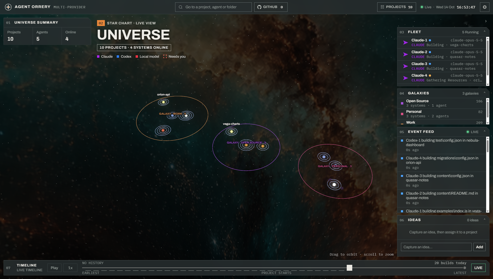
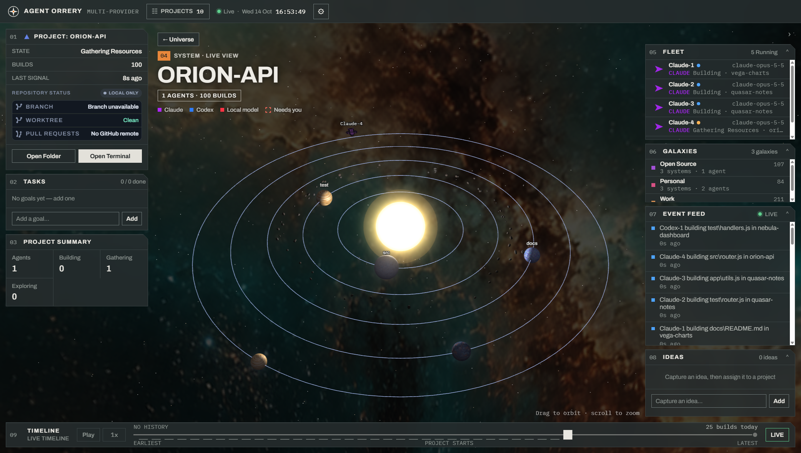
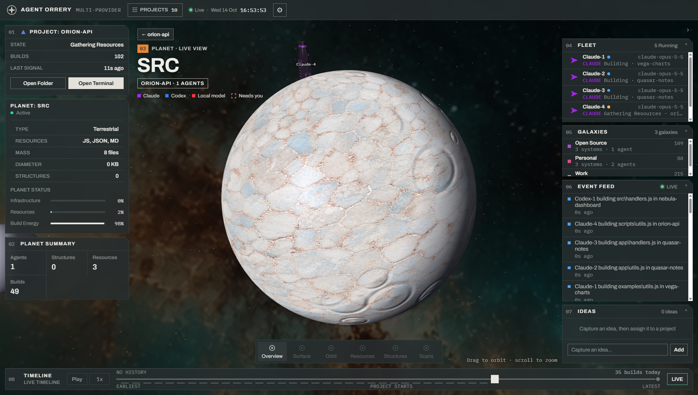

# Agent Orrery

A desktop app that turns your Claude Code and Codex sessions into a living universe you can fly around.

Every project you work on becomes a solar system, grouped into galaxies. Live agent sessions appear as starships orbiting the system; subagents launch as drones; and every verified file edit grows a planet. The app is purely an observer — it tails the providers' transcript files and visualizes what your agents are doing, without owning or interfering with them.

| Universe | Solar system | Planet |
| --- | --- | --- |
|  |  |  |

Real captures of the app running against a synthetic demo universe (fictional projects and sessions), produced by `node scripts/demo-shots.mjs`; see `docs/DEMO-MEDIA.md`.

## How it works

- **Projects are solar systems.** Each project directory found in your agent transcripts gets its own system, and related projects cluster into galaxies on the universe map.
- **Sessions are starships.** When a Claude Code or Codex session is active, a ship appears in that project's system. Subagents spawn as drones alongside it.
- **Edits grow planets.** Verified file edits accrete into planets, so a system's look reflects the real history of work done there.
- **Time travel.** A replay source indexes past transcripts, so you can scrub back through history and watch sessions play out, while live tracking keeps running in the background.
- **Passive by design.** The main process only reads provider JSONL transcripts. The two deliberate exceptions: opening a terminal at a project, and kicking off an agent on an item from the global IDEAS queue.

Built with Electron and Babylon.js. The renderer is fully offline — no network requests, local UMD bundles only.

## Getting started

Requirements: Node.js 22.12 or newer and npm. Windows and macOS are first-class, including the terminal-launch integration (see `docs/WINDOWS-LAUNCH.md` and `docs/MACOS-LAUNCH.md`); Linux runs the viewer without terminal control.

Get the code, then double-click the setup file in its folder:

- **Windows:** `Install Agent Orrery.cmd`
- **macOS:** `Install Agent Orrery.command`

It installs the dependencies, adds an **Agent Orrery** shortcut (Desktop and Start menu on Windows, `~/Applications` on macOS), and opens the app. `npm run setup` does the same from a terminal. Run it again after moving the folder.

To run it from a terminal without shortcuts, or on Linux:

```sh
npm install
npm start
```

`npm install` also downloads the Electron runtime through a `postinstall` step. If it was skipped or removed, `npx install-electron` restores it.

The app discovers projects and sessions by tailing your local Claude Code / Codex transcript directories. Click a system on the universe map to enter it, click a planet to get close, and use the timeline to replay history.

## Development

```sh
npm test                 # all tests (Node's built-in runner)
npm run typecheck        # check the JSDoc types (files that start with // @ts-check)
node kit/grade.mjs       # renderer regression gate — must stay green after any renderer change
npm run shots            # headless screenshots into .shots/ for visual comparison
npm run ships:generate   # regenerate procedural ship GLB assets
node scripts/demo-shots.mjs   # README screenshots from a synthetic universe (docs/DEMO-MEDIA.md)
```

Plain JavaScript throughout — no `.ts` files (types are JSDoc, checked by `npm run typecheck`), no bundler, no lint tooling. The renderer uses classic `<script>` tags attached to a single `window.AUR` namespace (no ES modules, since it runs from `file://`).

### Layout

- `src/main/` — Electron main process: transcript tailing (`tracker.js`), replay/history (`replay-source.js`), IPC, git/GitHub status, and the IDEAS queue.
- `src/renderer/` — three Babylon.js views (`scene-universe.js`, `scene-system.js`, `scene-planet.js`) orchestrated by `app.js`, one engine for the app lifetime with a scene per view.
- `kit/` — the contract-driven development workflow this repo is built with: `kit/SPEC.md` is the live renderer contract, `kit/RUBRIC.md` the visual acceptance reference, and completed kits under `kit/done/` keep their grading gates passing.
- `docs/` — design direction, roadmap, playback, multi-provider support, agent control, and Windows launch notes.

### The kit workflow

Features here are developed as self-contained "kits": a contract, a rubric, and a mechanical grading script, executed end-to-end by agents. That keeps hard decisions (what to build, how it's judged) separate from volume work (building it), and every finished kit leaves behind a regression gate that must stay green.

## License

MIT
